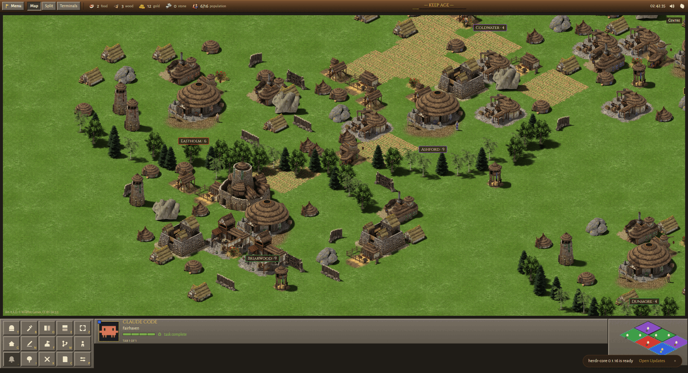

# Herdr Empires

```
Install Herdr Empires on my Herdr: clone https://github.com/cauldr0nx/herdr-empires to ~/.local/share/herdr-empires, read tools/install.sh, then run `sh ~/.local/share/herdr-empires/tools/install.sh install --switch`.
```

A medieval RTS theme for [Herdr](https://herdr.dev). Your workspaces become towns,
your agents become villagers who gather while they work, raise a **?** when they
need you, and show a **✓** when they're done. Towns grow with each repo's commits
and age.




## Use

- **Click a villager** to talk to it (a small window with its terminal). Drag the
  window by its title bar, resize from its corner, **Pin** to keep it open.
- **Right-click a building** to train a new agent there, move it, or change what it is.
- **Drag** the map to look around, scroll to zoom.
- **Map / Split / Terminals** in the top bar switch views. `ctrl-shift-l` leaves the
  theme and comes back.
- **Menu → Options → Hide names** swaps your workspace names for made-up town names,
  for screenshots.

## Install by hand

```sh
git clone https://github.com/cauldr0nx/herdr-empires && cd herdr-empires
sh tools/install.sh install --switch    # update: git pull && sh tools/install.sh update
                                         # remove: sh tools/install.sh uninstall
```

## Credits

World art is rendered from [0 A.D.](https://play0ad.com) by Wildfire Games
(CC BY-SA 3.0). Code is Apache-2.0. Details in [CREDITS.md](CREDITS.md).
