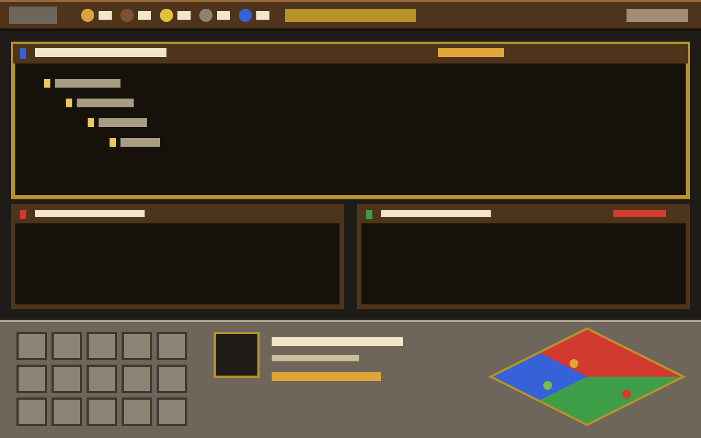

# Herdr Empires

A medieval RTS total-conversion layout for Herdr. The person sees a dark
wood-and-stone command HUD framing a warm "night camp" terminal: a wooden
resource bar across the top, terminals framed as units with plank banners,
and a stone HUD along the bottom with a command card, a selected-unit panel
and a diamond minimap. A herald floats at the bottom-left with news. Dialogs
and menus are parchment with gold trim. Agents are units, spaces are towns,
tabs are buildings; every counter counts something real and every button runs
a Herdr command.

## What you see

Top to bottom, at zoom 1:

1. **Resource bar**, 34 px, a wood plank (`#4f341c` with a `#7a5230`→`#2e1f12`
   gradient, a 1 px `#9a6a3c` grain line on top, `#1a1109` below). Left to
   right: a stone **Menu** button (flag glyph, Cinzel-free, Alegreya Sans
   bold); a 1 px dark divider; five counters, each a 20 px full-colour icon,
   a number in Alegreya Sans SC 14 px `#f1e6c8` and a small label in
   `#cdbf9c`: **food** (agents working), **wood** (idle), **gold** (tasks
   completed this session), **stone** (blocked, number pulses `#d63c2e` when
   > 0), **population** (live agents / cap, default 16). Centre: the **age
   banner**, "— VILLAGE AGE —" in Cinzel 12 px `#ecc95a` over a 3 px gold
   progress bar toward the next age. Right: the session clock `01:42:10`
   (Alegreya Sans SC), a speaker/mute glyph, a gear (Herdr settings), and on
   Linux/Windows three window buttons (minimize, maximize/restore, close; the
   close one turns red on hover). On macOS the bar leaves 78 px at the left
   for the traffic lights. The bar is `window_drag`.
2. **The field**: the active tab's panes with 8 px padding, 6 px gaps, 3 px
   `#4f341c` wood borders; the focused pane's border is gold `#b8922a`. Each
   pane has a 26 px **banner** header: a pennant in the town's player colour
   (blue `#3561d9`, red `#d23a2f`, green `#3e9e48`, yellow `#e2c13a`, cyan
   `#3cb3bf`, purple `#8a4fc2`, gray `#9b9b9b`, orange `#e3802c`, following
   Herdr's `space.colors` slots ansi1..8), a 20 px unit portrait (the
   program's icon in a stone well; gold trim when focused), the title
   `Claude Code · herdr-empires (main)` (bold, `~` for home, never an absolute
   path), then for agents a 54×7 px segmented HP-style bar: amber `#e0a63a`
   shimmering (opacity 0.55→1, 1.6 s) while working with "gathering 4m" from
   `working_since`, red `#d63c2e` pulsing (0.7 s) with crossed swords and
   "UNDER ATTACK" when blocked, green `#79bd4a` with a laurel and "task
   complete" when done, gray when idle; shells show no bar. A `⚒2` worker
   count appears when sub-agents are attached. Then stone buttons, 18×16 px,
   gold border on hover: garrison, split right, split down, zoom/unzoom,
   close. Terminals are `#16110b` with `#e7d9b6` text, JetBrains Mono.
3. **HUD**, 150 px, three stone panels (`#6e665a` face, `#b0a693`/`#8c8375`
   highlights, `#3d382f`/`#1f1c17` shadows, a `#776f62`→`#5e574c` gradient):
   - **Command card** (260 px): 3×5 stone buttons 46×40 with 18 px glyphs
     and a gold hotkey letter in the corner: Train, Build, Split →, Split ↓,
     Zoom / Garrison, Rename, Found town, Worktree, Idle unit / Bell, Tech
     tree, Close, Chronicle, Options. Pane buttons are disabled (darker face,
     pale glyph) with nothing focused; the Bell pulses while a unit is blocked.
   - **Selection panel** (flexible): the focused pane as a unit card: a 56 px
     gold-framed portrait with the town's colour chip, the unit name in
     Cinzel with the tab name in quotes, `town · folder · branch`, a 90 px
     status bar with the elapsed time, "tab 2 of 3", and the attached workers
     as 18 px portraits (click = peek). A mod pane shows its title. With
     nothing focused: the active town's buildings as 32 px pictures (house =
     tab, garrison = settled tab, tower = a blocked tab) with status badges;
     click = select the tab.
   - **Minimap** (220 px): a 196×98 diamond of territories, one rhombus per
     town in its player colour (active: 95 % opacity and a 2 px gold edge;
     others 75 %, 1 px dark edge; remote realms 55 % with a dashed cyan
     edge, "across the river"). Inside each: 8 px house/garrison glyphs per
     tab and 5 px dots per agent coloured by status, the focused one with a
     gold ring; blocked dots get a pulsing red ring. Click a territory to
     select the town, a dot to focus the agent. Below: an **idle N** button
     (cycles idle/done units) and a crossed-swords **alarm counter** (cycles
     blocked units). Above 12 towns the map becomes a wrapping row of 12×16
     px banners instead.
4. **Herald**: a floating 56×72 original character (red hat, blue tabard,
   scroll and trumpet) at the bottom-left of the field, bobbing 4 px while
   there is news, with a 210 px parchment speech bubble: "A claude scholar in
   api awaits your orders." and three links: Take me there, Dismiss, Silence
   the herald.

Menus are parchment (`#e9d8ae`, gradient to `#f0e2bd`, `#c9b07a` edge, 2 px
`#4f341c` frame) with 22 px rows, a 13 px glyph column, access-key
underlines, shortcuts in `#6b5536`, submenu arrows; the hovered row is
`#ecc95a`. Dialogs are parchment scrolls under a 28 px wood header with a
Cinzel caption and an ornament; the default button carries a 14 px wax seal.

Narrower than 900 px, the resource bar drops its labels and the age banner
shrinks; the HUD collapses to two rows (selection on top, command card and
minimap below). Options offers a 2× HUD scale that doubles every HUD pixel.

## How it behaves

- **Status** (`working / blocked / done / idle`): amber shimmer, hourglass
  badge, "gathering 4m" · red pulse, crossed swords, "UNDER ATTACK", minimap
  ping, the Stone counter pulses, the Bell button pulses, the herald speaks ·
  green, laurel, "task complete", herald speaks until seen · gray, nothing.
  Sounds for blocked/done play only when Options → "Use Empires alert sounds"
  is on (it writes `settings.json` `sounds.done/blocked` to our files and
  restores the previous values on un-check); Herdr's own alert sounds are
  never doubled.
- **Clicks**: Menu → game menu (Options, Tech tree, Chronicle, Hide HUD,
  Mute, Summon the herald, Herdr settings, Command palette, Resign, About).
  Stone → first blocked agent (`agent.focus`); Wood → next idle; Gold or the
  age banner or the clock → Chronicle; Population/Food → Options. Banner:
  click focuses the pane, double-click zooms, right-click opens the context
  menu (Garrison, Split right/down, Zoom, Rename building, Workers ▸ peek,
  Close unit). Command card buttons run `tab.new`, `pane.split`, `pane.zoom`,
  `tab.settle`, `tab.rename`/`space.rename` (prompt), `space.new` after
  `pickFolder`, the shipped `worktree` dialog, `agent.focus`, dialogs,
  `pane.close`. Minimap: territory → `space.select`, dot → `agent.focus`.
  Selection: worker portrait → `terminal.peek`, building → `tab.select`.
  Herald: Take me there → `agent.focus`.
- **Keys** (`layout:empires`): `alt-.` next idle/done, `alt-,` next blocked,
  `alt-m` menu, `alt-t` Train dialog, `alt-g` settle, `ctrl-shift-h`
  `layout.toggle hud`, `f1` Tech tree; also `options`, `chronicle`, `boot`.
  `ctrl-shift-l` leaves (Herdr). Menus: arrows, Enter, access keys, Esc.
  Dialogs: Enter = default button, Esc = close; prompts type into a
  parchment field with a blinking caret.
- **Ages**: tasks completed (an agent going working → done or idle) advance
  Camp (0) → Village (3) → Keep (10) → Crown (25, configurable): a 52 px wood
  banner slides over the top for 3 s ("You have advanced to the Keep Age") with
  a fanfare; the Crown Age shows the victory screen (a crown on a dark field,
  4 s, click to dismiss). Calm mode hides all of it.
- **Loading screen**: entering the layout (at most every 30 min) shows a
  full-window castle at dusk with a tip, a gold progress bar that fills at
  1 s, and closes at 2 s; a click or any key skips it; a horn plays.
- **Chronicle**: every status transition (time, town, unit, from → to) kept
  in `shared("empires.chronicle")` (last 500); the Chronicle dialog shows per
  town: completed, attacks, time working, time blocked, plus the last events.
- **Herald** news: the most urgent, most recent blocked/done agent that is
  not focused; dismissed items return when the agent changes state.
- **What moves**: only native motion: `.loop("opacity")` shimmers and pulses,
  the herald's `.loop("top")`, the loading bar's `.transition("width")`. No
  timers faster than 1 s (the clock ticks once a second).

## Built from

- `layouts/empires.json`: root column (`titlebar: none`, `theme: empires`,
  `ui_font: Alegreya Sans`, `font: JetBrains Mono`, background `#1f1c17`,
  `terminal_padding [6,4]`, `x_empires.version`): `resources` block (34 px,
  `window_drag`, mod `empires` role `resources`) · `field` row (padding
  [8,8]) with `main` block `{tab: "active"}` whose pane frame is gap 6, radius
  0, border 3 `#4f341c`, focus 3 `#b8922a`, `lone: true`, header mod `empires`
  role `banner` 26 px top always, and a floating `herald` (edge left, align
  end) · `hud` row (150 px, not resizable): `command` 260 px, `selection`,
  `minimap` 220 px, each mod `empires` with its role.
- `themes/empires.json` (layout-owned: bg `#16110b`, fg `#e7d9b6`, selection
  `#5a4320`, 16 warm ANSI colours all ≥ 4.5:1, and named panel colours:
  popover parchment, border wood, accent gold, working/blocked/done/idle);
  `themes/empires-parchment.json` (light) and `empires-dusk.json` (dark) for
  any layout.
- `mods/empires/main.js` routes `props().role` → `roles/{resources, banner,
  command, selection, minimap, herald, menu, dialog}.js`; `kit.js` (palette
  `C`, `unit()` = design px × scale ÷ zoom, `bevel()` from stacked 1 px
  borders, `plank`, `stone`, `parchment`, `goldFrame`, `button`, `control`,
  `statusBar`, `statusBadge`, `pennant`, `programIcon`, `openMenu`,
  `openDialog`, `perform`, `sfx`, `fitLayout`); `data.js` pure view-model
  (`shortenPath`, `paneTitle`, `resourceCounts`, `ageFor`, `transitions`,
  `scoreboard`, `orderAgents`, `nextIdle/nextBlocked`, `territories`,
  `heraldLine/heraldNews`, `techTree`), unit-tested with `bun test`.
- `herdr` functions used: `spaces, agents, panes, terminals, focused, run,
  shared, setShared, nextCommand, settings, window, exec (ps for the app
  age), keys, knownAgents, pickFolder, playSound, openOverlay, closeOverlay,
  layout, placement, home, appHome, readTextFile, writeTextFile
  (settings.json for alert sounds), setAgentOrder`. Commands: `space.select,
  space.new, space.rename, tab.new, tab.select, tab.settle, tab.rename,
  pane.focus, pane.split, pane.zoom, pane.close, agent.focus, terminal.peek,
  layout.toggle, layout.resize, layout.set, layout.switch, app.settings,
  app.palette, window.minimize/maximize/close`. The shipped `worktree` mod
  opens as a dialog with `{space, action: "new"}`.
- Shared state `empires.*`: `session {startedAt, completed, age}`,
  `chronicle`, `resources` (mapping), `popcap`, `ages` (thresholds), `scale`
  (1|2), `mute`, `alerts`, `prevSounds`, `herald` ("off"), `boot` ("off"),
  `bootAt`, `calm`, `hud` ("hidden"), `menus` (open menu stack), `command`
  (Phase 2), `groups`, `queue.<space>`, `rally.<space>`, `autodispatch.<space>`.
- `keys.json` section `layout:empires` (above).
- Art: `art/generate.ts` draws 50 one-colour glyphs (`icons/*.svg`,
  `currentColor`) and the full-colour pictures (`img/*.svg`: food, wood,
  gold, stone, population, town, house, tower, garrison, frames, ornament,
  seal, status badges, logo, the loading screen); `art/textures.ts` the
  wood/parchment/stone pictures, the herald, victory/resign screens and
  `layouts/empires.svg`; `art/sounds.ts` eleven FFmpeg `aevalsrc` sounds
  (horn, bell, done, ageup, click, knock, error, select, train, victory,
  resign). Fonts: Cinzel (variable), Alegreya Sans, Alegreya Sans SC (OFL).
- Demo profile: `tools/demo/run-demo.sh` (Xvfb, throwaway app home, two
  towns, `tools/demo/fake-agent.sh` emitting `ESC ] 7501 ; state=<word>:app=demo-agent ESC \`
  for working/blocked/done/idle, `herdr-app shot` into `shots/`).
- Programs run: `sh -c 'ps -o etime= -p "$PPID"'` once at start (to decide
  whether to boot); Phase 2 runs `hc` for send/interrupt/kill/templates.

## Watch out

- `herdr-app check` loads the mod with `props()` null: `main.js` renders a
  placeholder for an unknown role; every role tolerates empty data and a null
  `focused()`.
- Never keep a `cx`; `setShared` inside `render` re-renders every mod, so the
  chronicle and `fitLayout` writes happen in `cx.spawn` and only when something
  changed.
- `image()` cannot tile or 9-slice (no `object_fit`): frames are stacked
  borders and gradients; pictures stretch over their box (`preserveAspectRatio
  ="none"`). There is no rotation: the diamond is paths, not rotated squares.
- `paint_path` elements take no id or clicks: minimap hit areas are invisible
  absolute divs over each territory's bounding box (so a click near a corner
  can select the neighbour).
- SVG text needs fonts the renderer may not have: every picture is text-free;
  words are drawn by the roles.
- `openOverlay` sizes are layout px at zoom 1: divide design px × scale by
  `settings().zoom` (see `openMenu`).
- Herdr already plays attention sounds; the theme's alert sounds are opt-in.
- The resource bar's width comes from `on_size_change` on its root; the
  narrow layout and label dropping follow it.
- `layout.set` rewrites the whole tree (personal layouts only); per-field
  clicks in `layouts/.state/` beat a file edit, so sizes also go through
  `layout.resize`.
- Program icons in portraits come from the person's `icons/` folder, not from
  this repository; a program without an icon gets our worker/unit glyph.
- Phase 2 lives behind `shared("empires.command")` (Options): `roles/orders.js`
  swaps the command card's slots, `roles/queue.js` keeps the per-town queue
  and dispatches on idle transitions (from the resources role's tracker),
  `empires.selected` / `empires.groups` hold the selection and control
  groups by terminal address. The worker path's `hc run` flags are from
  the spec and must be confirmed against `hc run --help`.
- Not done yet: a PowerShell installer (Phase 3); `preview.png` is a mock
  until a Herdr machine takes a screenshot; the Phase 2 token/cost adapters
  are absent (counters hide rather than estimate).

## Done when

- `bun test`, `bun tools/check.ts mods/empires`, `bun tools/asset-check.ts`,
  `bun tools/contrast.ts`, `sh tools/hygiene-check.sh`, `sh tools/install-test.sh`
  all pass; on a Herdr machine `herdr-app check mods/empires` passes.
- `tools/install.sh --home "$(mktemp -d)" install --switch` yields a working
  layout; `uninstall` leaves the home byte-identical except Herdr's state.
- A blocked agent pulses red in its banner, in the Stone counter, on the
  minimap (ping ring) and on the Bell button within one render; `alt-,` and
  the Bell go to it; the herald offers "Take me there".
- Every command-card slot works by mouse, and the key table above by key.
- No absolute home path appears anywhere in the UI (the tests prove the
  functions; look at the banners).
